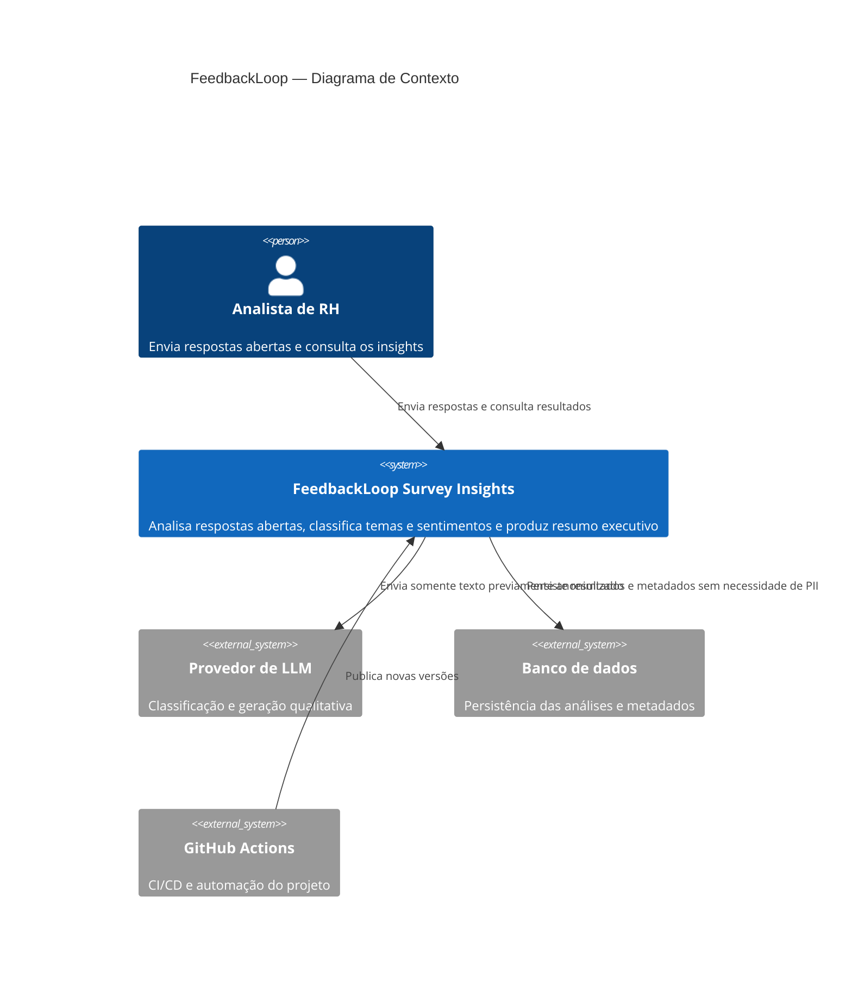

# C4 — Nível 1: Contexto do Sistema

## Leitura

O sistema central é o FeedbackLoop. O usuário interage com a aplicação para fornecer respostas e consultar a análise.

O provedor de LLM é um sistema externo e recebe apenas conteúdo após a etapa de anonimização. A persistência fica fora da interface e o GitHub Actions participa do ciclo de entrega.
